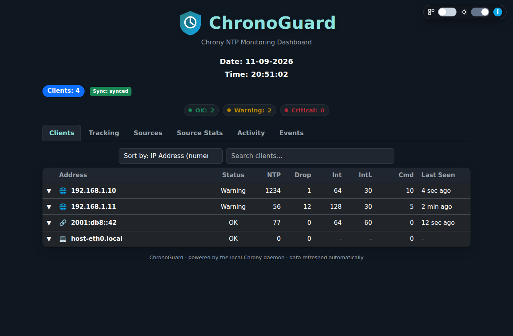

<div align="center">


# ChronoGuard

**Live Chrony NTP monitoring dashboard** — clients, server tracking, sources,
statistics, activity and host events, all in a single self-hosted Flask app.


</div>

<p align="center">
  
</p>

---

## What it does

ChronoGuard talks to the `chronyc` command line client on your Chrony server and
renders everything it reports as a live, auto-refreshing dashboard:

| Panel       | Shows |
|-------------|-------|
| **Clients** | Every NTP client connected to the server — packet counts, drops, intervals, last-seen, severity (OK / Warning / Critical) |
| **Tracking**| Server sync state: leap status, stratum, offsets, frequency drift, skew, root delay |
| **Sources** | Upstream NTP sources with source-state colors, reachability, last sample |
| **Source Stats** | Per-source measurement stats (samples, drift, jitter) |
| **Activity** | Online / offline / burst-resync / unknown source counts |
| **Events**   | A live feed of host chrony events (time corrections, source changes) |

Every panel polls a single fast JSON endpoint — one round-trip per refresh, so
it stays light even on modest hosts. All assets (Bootstrap, jQuery) are vendored
locally: **no CDN, no internet, no external services required**.

## Quick start

You only need one thing: a Chrony server (the app runs on it, or points at it).

### Option A — one-command installer (recommended)

Clones, sets up a venv, installs deps, adds the chronyc sudo rule and starts a
systemd service:

```bash
git clone https://github.com/OneByJorah/ChronoGuard.git
cd ChronoGuard
./install_chronoguard.sh          # idempotent — safe to re-run
```

Dashboard: **http://<your-ip>:5000/**. Tear everything down with `./uninstall_chronoguard.sh`.

### Option B — bare Python

```bash
git clone https://github.com/OneByJorah/ChronoGuard.git
cd ChronoGuard
python3 -m venv venv && source venv/bin/activate
pip install -r requirements.txt
python3 chronoguard.py            # or: gunicorn --bind 0.0.0.0:5000 chronoguard:app
```

Open **http://localhost:5000**.

### Option C — Docker

```bash
docker compose up -d --build       # mounts the host chrony socket by default
CHRONY_HOST=100.100.163.11 docker compose up -d --build   # remote daemon
```

`CHRONY_HOST` only needs setting when the container can't see the daemon's
socket (see `.env.example`).

## Configuration

Everything is optional and read from environment variables at startup:

| Variable | Default | Description |
|----------|---------|-------------|
| `FLASK_HOST` | `0.0.0.0` | Bind address |
| `FLASK_PORT` | `5000` | Server port |
| `FLASK_DEBUG` | `false` | Debug mode (never in production) |
| `REFRESH_INTERVAL` | `3000` | Dashboard refresh interval (ms) |
| `CHRONYC_PATH` | auto-detect | Path to `chronyc` |
| `CHRONYC_TIMEOUT` | `15` | Seconds before a chronyc call gives up |
| `CHRONY_HOST` / `CHRONY_PORT` | *(empty)* / `323` | Remote chrony daemon (Docker) |
| `EVENTS_LOG` | auto-detect | Path to the chrony log (falls back to `journalctl`) |
| `EVENTS_TAIL` | `100` | Number of trailing events to show |

See [`.env.example`](.env.example) for a copy-paste template.

## Endpoints

| Endpoint            | Description |
|---------------------|-------------|
| `GET /`             | Dashboard UI |
| `GET /api/summary`  | All sections in one JSON payload (what the UI polls) |
| `GET /api/clients`  | Parsed `chronyc clients` rows |
| `GET /api/tracking` | Server sync/offset data |
| `GET /api/sources`  | NTP sources (state, reach, samples) |
| `GET /api/sourcestats` | Per-source statistics |
| `GET /api/activity` | Source online/offline counts |
| `GET /api/events`   | Tail of host chrony events |
| `GET /api/health`   | Liveness check |
| `GET /data`         | Alias for `/api/clients` (back-compat) |

If any underlying command fails (binary missing, daemon down, timeout) the JSON
still returns — the affected section carries an `error` string instead of the
dashboard crashing.

## How chronyc access works

ChronoGuard tries plain `chronyc` first (read-only commands are allowed over the
local unix socket without root) and falls back to `sudo chronyc`. The installer
adds a scoped `NOPASSWD` rule for exactly `/usr/bin/chronyc`, so the service can
always monitor without ever needing an interactive password.

## Project structure

```
ChronoGuard/
├── chronoguard.py              # Flask app (runnable: python3 chronoguard.py)
├── requirements.txt            # runtime deps (pinned)
├── requirements-dev.txt         # test/lint deps
├── install_chronoguard.sh      # one-command systemd installer
├── uninstall_chronoguard.sh    # full teardown
├── chronoguard.service         # systemd unit
├── Dockerfile / docker-compose.yml
├── .env.example
├── templates/index.html        # dashboard template
├── static/
│   ├── css/style.css
│   ├── js/app.js
│   ├── img/chronoguard-logo.svg
│   └── vendor/                 # vendored Bootstrap 5 + jQuery (offline)
├── tests/                      # mock chronyc + pytest suite
├── docs/assets/                # banner + screenshot
└── .github/workflows/          # CI (ruff + pytest) and CodeQL
```

## Running as a service (systemd)

The installer does this for you; doing it by hand:

```bash
sudo cp chronoguard.service /etc/systemd/system/
# edit User= to your account, then:
sudo systemctl daemon-reload
sudo systemctl enable --now chronoguard
```

## Monitoring a remote Chrony server

The dashboard runs anywhere; point it at a remote daemon with `CHRONY_HOST` set,
and grant that host a socket (`-S` in `chronyd.conf`) or open UDP/323. On the
JorahOne tailnet this pairs naturally with a self-hosted Chrony server — no
public exposure required.

## Contribute & feedback

Contributions welcome — see [CONTRIBUTING.md](CONTRIBUTING.md) and
[CODE_OF_CONDUCT.md](CODE_OF_CONDUCT.md). Report vulnerabilities privately via
[SECURITY.md](SECURITY.md).

## License

[MIT License](LICENSE) © Jhonattan L. Jimenez (OneByJorah) — see [jorahone.com](https://jorahone.com).

---

<p align="center">Built with 🌴 by <a href="https://github.com/OneByJorah">OneByJorah</a></p>
